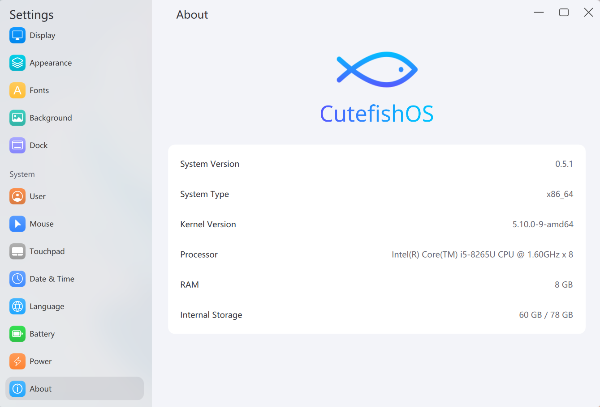

# Settings

The System Settings application for Cutefish Desktop.



## Dependencies

Settings is built on [cutefish-toolkit](https://github.com/cutefishos/cutefish-toolkit)
and the Qt-free clients of [cutefish-framework](https://github.com/cutefishos/cutefish-framework);
install those first.

Arch/Manjaro Dependencies:
```shell
sudo pacman -S cmake pkgconf icu libxcrypt fontconfig libxcursor libxkbcommon expat systemd-libs
```

Debian/Ubuntu Dependencies:
```shell
sudo apt install cmake pkg-config libicu-dev libcrypt-dev libfontconfig-dev libxcursor-dev libxkbcommon-dev libexpat1-dev libsystemd-dev
```

## Build

```shell
mkdir build
cd build
cmake -DCMAKE_INSTALL_PREFIX:PATH=/usr ..
make
sudo make install
```

## License

BSD-3-Clause; see [LICENSE](LICENSE).
